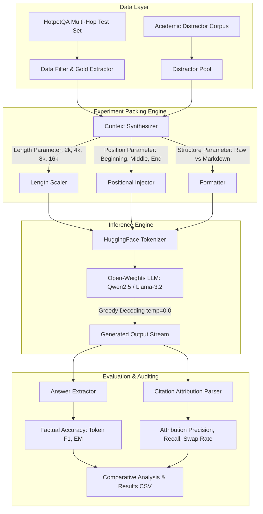

# Frozen Experiment Blueprint & Protocol (Gate G2 / Prompt 07)

**Project**: Context-Window Degradation in Multi-Document Academic Research Synthesis  
**Target Questions**: RQ1 (Hop Degradation), RQ2 (Positional Attribution Bias), RQ3 (Structural Ablation)  
**Status**: FROZEN (All metrics, test partitions, and protocols locked prior to result viewing)  

---

## 1. System Architecture & Workflow



---

## 2. Experimental Specifications & Frozen Parameters

### 2.1 Input / Output Specifications
- **Input Format**:
  ```text
  You are an academic research assistant. Answer the question using ONLY the provided documents.
  For every claim in your answer, cite the supporting document using its bracketed tag, e.g., [Doc 1].
  
  === DOCUMENTS ===
  [Doc 1] Title: ... Content: ...
  [Doc 2] Title: ... Content: ...
  ...
  
  === QUESTION ===
  {question}
  
  === ANSWER ===
  ```
- **Output Schema**:
  - `generated_text`: raw string from model.
  - `predicted_answer`: extracted answer string.
  - `predicted_citations`: list of cited document tags (e.g. `["Doc 1", "Doc 4"]`).

### 2.2 Controlled Variables & Grid
1. **Context Length ($L$)**: 4 levels $\in \{2048, 4096, 8192, 16384\}$ tokens.
2. **Gold Evidence Position ($P$)**: 3 levels $\in \{\text{Beginning [0–25\%]}, \text{Middle [25–75\%]}, \text{End [75–100\%]}\}$.
3. **Reasoning Complexity ($C$)**: 2 levels $\in \{\text{Single-Hop Extraction}, \text{Two-Hop Cross-Document Synthesis}\}$.
4. **Structural Boundary ($S$)**: 2 levels $\in \{\text{Unstructured Flat Concatenation}, \text{Structured Markdown Tags}\}$.
5. **Sample Size**: 50 frozen instances per cell across standard evaluations (total 1,200 evaluation passes in full matrix; 100 core instances for benchmark comparisons).

### 2.3 Evaluation Metrics (Directionality Explicitly Defined)
- **Token F1 (Answer Correctness)**: Token-level harmonic mean of precision and recall between predicted answer and gold answer. *(Higher is better $\uparrow$, Range: [0.0, 1.0])*
- **Exact Match (EM)**: Binary 1/0 indicator if normalized prediction matches gold answer exactly. *(Higher is better $\uparrow$, Range: [0.0, 1.0])*
- **Attribution Precision (Att-P)**: Ratio of correctly cited gold document tags to total predicted document tags. *(Higher is better $\uparrow$, Range: [0.0, 1.0])*
- **Attribution Recall (Att-R)**: Ratio of cited gold document tags to total required gold document tags. *(Higher is better $\uparrow$, Range: [0.0, 1.0])*
- **Citation Swap Error Rate (Swap-ERR)**: Frequency with which a distractor document is cited in place of a gold document. *(Lower is better $\downarrow$, Range: [0.0, 1.0])*
- **Degradation Slope ($\beta_L$)**: Linear regression slope of Token F1 over context length: $\frac{\Delta \text{F1}}{\Delta \log_2(L)}$. *(Less negative is better $\uparrow$)*

### 2.4 Random Seed & Determinism Controls
- Global random seed: `SEED = 42` (applied to Python `random`, `numpy`, `torch`).
- Decoding parameters: `temperature = 0.0`, `do_sample = False`, `max_new_tokens = 64`.

---

## 3. Deep Analyses Plan
1. **Relational Degradation Delta**: Compare $\beta_{L, \text{2-hop}}$ vs. $\beta_{L, \text{1-hop}}$ to test if relational reasoning suffers accelerated degradation.
2. **Positional Attribution Vulnerability**: Compute U-curve dip ratio: $\text{Dip} = \frac{\text{Metric}_{\text{Middle}}}{\frac{1}{2}(\text{Metric}_{\text{Beg}} + \text{Metric}_{\text{End}})}$ for both Answer F1 and Attribution Recall.
3. **Failure Mode Taxonomy**: Categorize incorrect predictions into:
   - Factual Hallucination (answer hallucinated from pre-training memory).
   - Distractor Capture (distractor entity selected as answer).
   - Attribution Omission (answer correct, citation omitted).
   - Attribution Swap (answer correct, distractor cited).

---

## 4. Threats to Validity & Safeguards
- **Parametric Memorization**: High-frequency Wikipedia entities can be answered from parametric memory rather than context. *Safeguard: Evaluate supporting fact attribution; require explicit document-grounded citation.*
- **Attention Cache Artifacts**: Dynamic key-value cache reallocation causing timing or accuracy jitter. *Safeguard: Clear CUDA cache between instances, process single-sequence inference without state leakage.*
- **Prompt Sensitivity**: Models are sensitive to prompt phrasing. *Safeguard: Use the official ChatML / Instruct template for the model family.*

---

## 5. Frozen Pre-Experiment Checklist
- [x] Primary metrics frozen: Token F1, Exact Match, Attribution Precision, Attribution Recall, Citation Swap Rate.
- [x] Test split frozen: 100 deterministic HotpotQA multi-hop instances (`test_instances_frozen.json`).
- [x] Random seed frozen: `SEED = 42`.
- [x] Decoding parameters frozen: `temperature = 0.0`, `do_sample = False`.
- [x] Protocol change rule: Any adjustment to prompts, metrics, or thresholds must be documented in `research_decisions.md` with an explicit reason before running experiments.
